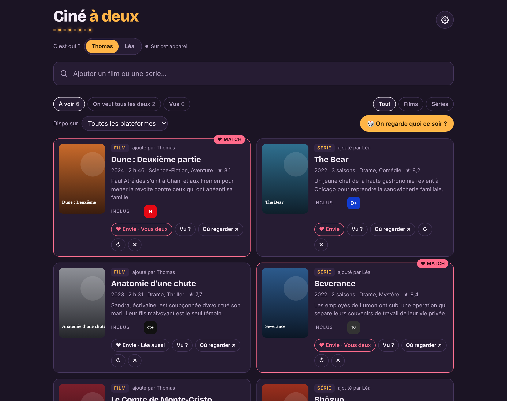

# Ciné à deux

La liste des films et séries à voir à deux. Tapez un titre : l'appli propose les films et séries qui existent, puis récupère l'affiche, le résumé et les plateformes où le regarder (Netflix, Prime Video, Disney+…).

Adresse : `https://alcor-cyber.github.io/Maison-a-Deux/cine/`

## Premier lancement

1. Créez un compte gratuit sur [themoviedb.org](https://www.themoviedb.org/signup), puis copiez la « Clé d'API » dans [Paramètres → API](https://www.themoviedb.org/settings/api).
2. Dans l'appli, ouvrez les réglages (⚙︎), collez la clé et mettez vos deux prénoms.

La clé reste dans le navigateur de chaque téléphone. Elle n'est pas enregistrée dans ce dépôt public.

## Liste commune sur les deux téléphones (optionnel)

Sans réglage, chaque téléphone garde sa propre liste. Pour en partager une seule, créez une « Realtime Database » dans Firebase, puis collez son adresse et le même code secret dans les réglages des deux téléphones.

| Téléphone | Ordinateur |
|---|---|
|  |  |

(Les affiches et logos des captures sont des exemples dessinés ; l'appli affiche les vrais.)
